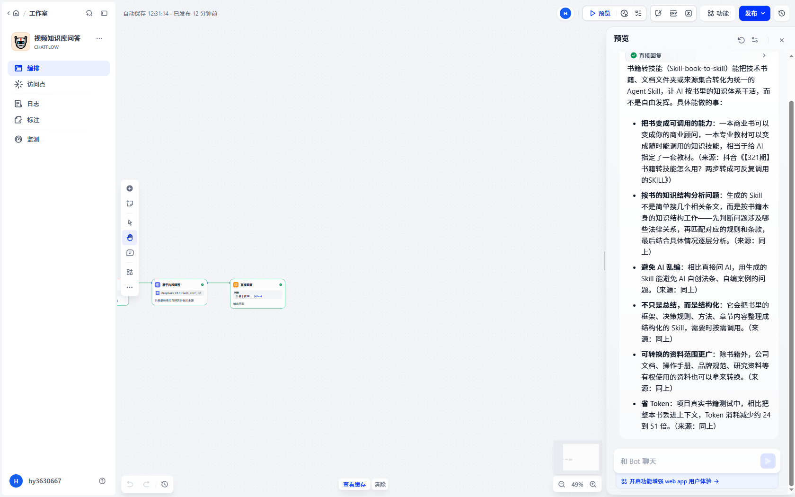
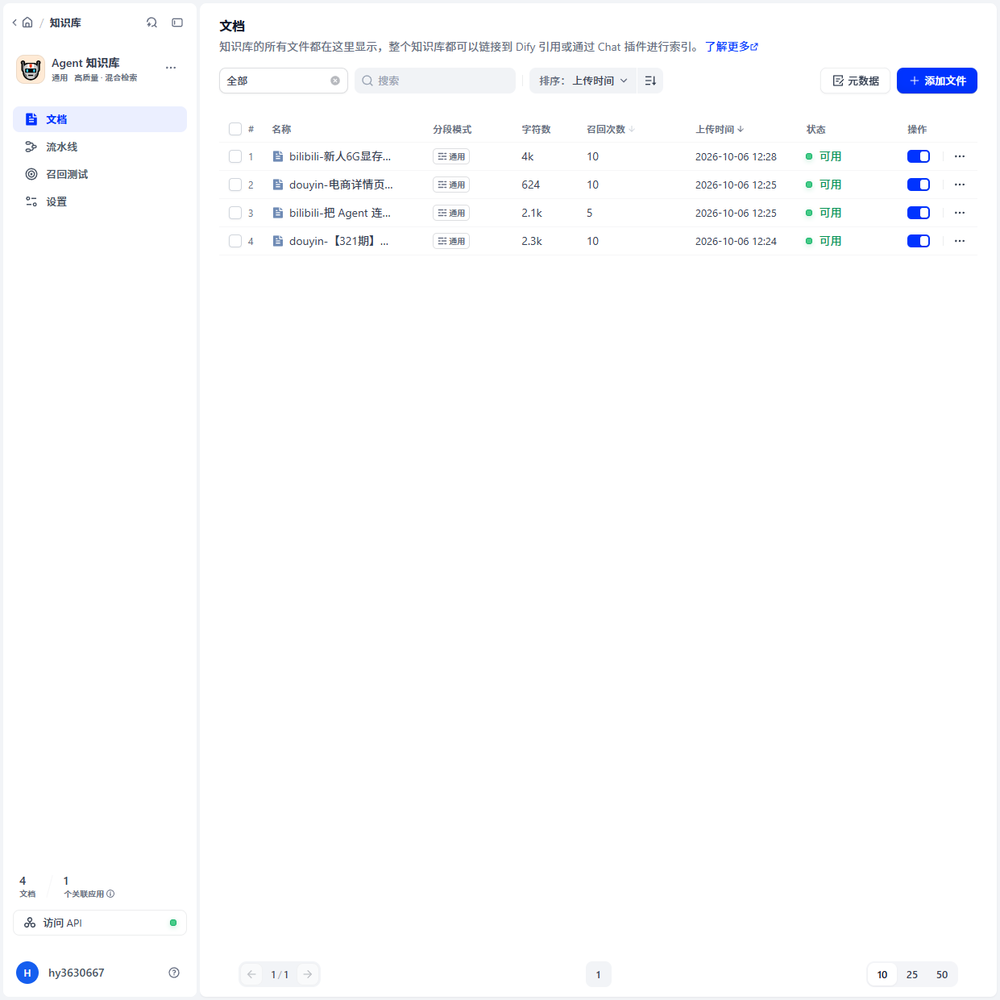
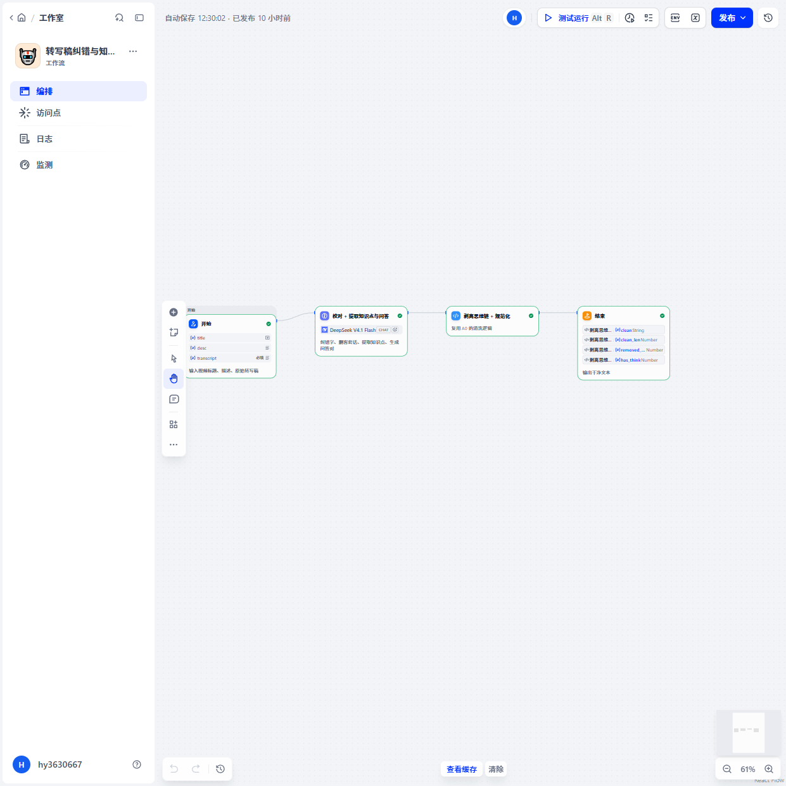
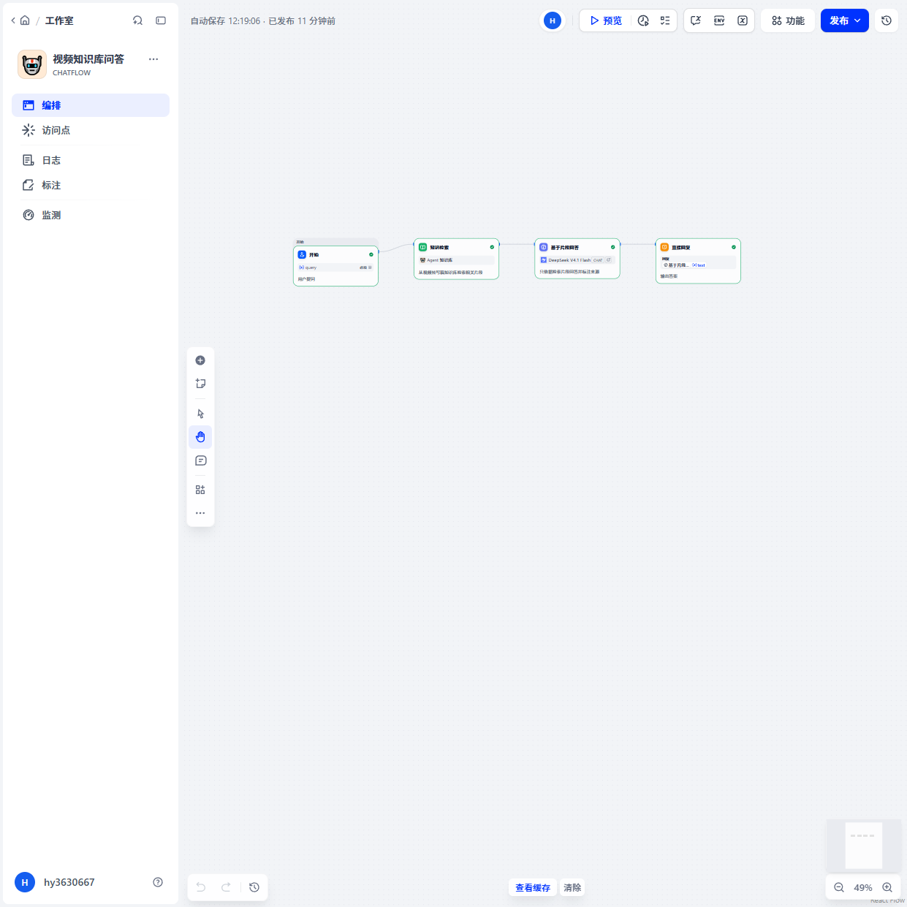
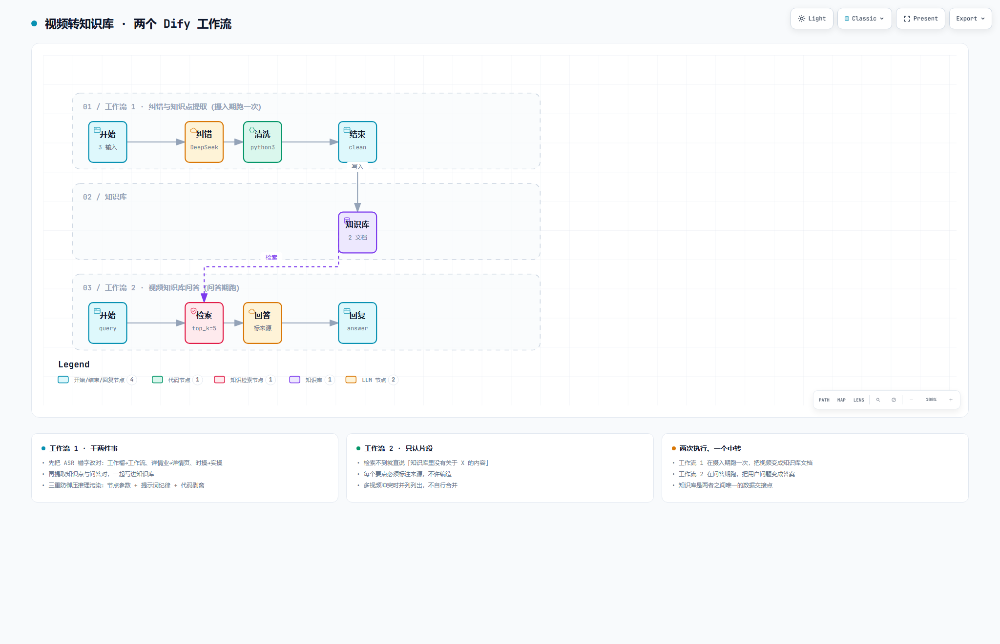

# video-to-knowledge-base

> 把任意视频链接变成可问答的 AI 知识库
> 抖音 / 小红书 / B站 → 自动转写 → LLM 纠错 → 向量入库 → 自然语言问答

**一个 12 分钟的对标视频，从链接到可问答知识库，147 秒。全程零 API 成本。**

---

## 它解决什么问题

做内容运营/研究需要大量看对标视频，但**看完就忘，想找某个点要拖进度条**。平台也没有「按语义搜视频内容」的功能。

这个工具把视频转成可检索、可问答的知识库：

| 传统做法 | 这个工具 |
|---|---|
| 想回看「他讲的那个参数是多少」→ 手动拖进度条 | 直接问，几秒给答案并标注来源 |
| 十几个视频散在收藏夹，没法跨视频检索 | 统一入库，跨视频提问 |
| 视频没有文字稿，不可搜索 | 自动转写 + 纠错 + 结构化 |

---

## 实测性能

全部为真实测量（4 个真实视频，含一个 11.6 分钟的长视频）：

| 视频时长 | 抓取 | ASR 转写 | LLM 纠错 | **全链路** | 转写倍率 |
|---|---|---|---|---|---|
| 27 秒（抖音） | 1.0s | 4.0s | 2.1s | **15.1s** | 6.86x |
| 87 秒（B站） | 1.1s | 19.3s | 3.5s | **31.6s** | 4.58x |
| 145 秒（抖音） | 3.1s | 44.1s | 5.4s | **61.1s** | 3.34x |
| **697 秒（B站）** | 3.7s | 130.9s | 11.5s | **147.2s** | 5.58x |

**关键结论（实测修正了初版估算）：**
- 转写倍率**波动很大**（3.34x ~ 6.86x），不是平滑曲线
- 保守规划值：**1 小时音频 ≈ 15–18 分钟**（最初估 9 分钟，偏乐观）
- **全程零 API 成本**：ASR 本机跑，抓取工具自托管

**验收测试 6 项：**

| # | 测试 | 结果 |
|---|---|---|
| ① | 4 个视频各问一个专属问题 | ✅ 4/4 正确，均标注来源 |
| ② | 跨视频区分 | ✅ 正确识别视频来源 |
| ③ | **防幻觉：问知识库里没有的内容** | ✅ **正确拒答** |
| ④ | 架构图渲染校验 | ✅ 9/9 检查、0 错误 0 警告、4 个分辨率无溢出 |
| ⑤ | 工作流发布 | ✅ 2/2 |
| ⑥ | RAG 聚合统计（「有几个视频」）| ⚠️ **答错** —— 见「已知局限」|

---

## 效果截图

**问答实测**（工作流 + 回答 + 来源标注同框）：



**知识库文档列表**（4 个视频真入库，标签可见「混合检索」）：



**两个工作流**：

| ① 转写稿纠错与知识点提取 | ② 视频知识库问答 |
|---|---|
|  |  |

**系统架构图**（可交互版：[docs/架构图.html](docs/架构图.html)）：



---

## 系统架构

```
视频链接（抖音 / 小红书 / B站）
    │
    ├─ ① 抓取 ────────────────────────────────────────
    │     抖音/TikTok → Douyin_TikTok_Download_API（自托管，:8080）
    │     B站        → 同服务（专门端点，dash 分离流 + ffmpeg 合并）
    │     小红书      → XHS-Downloader（REST API，:5556）
    │
    ├─ ② ASR 转写 ────────────────────────────────────
    │     ffmpeg 抽 16kHz 单声道 WAV
    │     → faster-whisper（CPU int8，small 模型）
    │
    ├─ ③ LLM 纠错（Dify 工作流 ①）────────────────────
    │     开始 → LLM(thinking:false) → 代码(剥思维链) → 结束
    │     做四件事：纠错字 / 删客套话 / 提知识点 / 生成问答对
    │
    ├─ ④ 写入知识库 ──────────────────────────────────
    │     自定义分段（每块带【视频标题】前缀）→ Dify 知识库
    │
    └─ ⑤ RAG 问答（Dify chatflow ②）──────────────────
          开始 → 知识检索（混合检索）→ LLM → 直接回复
```

---

## 快速开始

### 方式 A：只想看代码和设计（推荐）

不需要跑起来。看这些：

| 文件 | 内容 |
|---|---|
| [`docs/技术文档-18个坑.md`](docs/技术文档-18个坑.md) | **最有价值**：18 个真实踩坑记录，含源码行号 |
| [`scripts/one-click-pipeline.py`](scripts/one-click-pipeline.py) | 主脚本（含大量注释说明「为什么这样做」）|
| [`workflows/`](workflows/) | 两个 Dify 工作流 DSL（可导入）|
| [`docs/架构图.html`](docs/架构图.html) | 可交互架构图（切主题/缩放/导出）|

### 方式 B：跑通 ASR 部分

只需要 Python + ffmpeg，不需要 Dify：

```bash
# 1. 装依赖
pip install faster-whisper opencc numpy requests

# 2. 准备一个视频/音频文件

# 3. 转写（绕过 faster-whisper 的 PyAV bug，见下方说明）
python scripts/test-asr2.py your-video.mp4 small
```

`test-asr2.py` 会打印：音频时长、转写耗时、**实时倍率**、带时间戳的转写结果。

> ⚠️ **为什么要单独写这个脚本**：faster-whisper 1.1.0 / 1.2.1 都有个 PyAV 兼容 bug（`av.open(..., metadata_errors=...)` 参数在本机 PyAV 上不存在）。这个脚本用 ffmpeg 自己抽音频、转成 numpy 数组直接喂模型，**绕过了 `decode_audio`**。详见技术文档「坑 5」。

### 方式 C：跑通全链路

需要 Docker + Dify + Ollama，步骤：

```bash
# 1. 部署 Dify（官方 docker compose）
#    https://docs.dify.ai/getting-started/install-self-hosted

# 2. 部署抓取服务
docker run -d --name dtk-v4 -p 8080:80 --restart unless-stopped \
  evil0ctal/douyin_tiktok_download_api:V4.1.2

# 3. 部署小红书抓取（可选）
#    https://github.com/JoeanAmier/XHS-Downloader
#    python main.py API      # 监听 :5556

# 4. 导入两个工作流
#    Dify 工作室 → 创建 → 导入 DSL 文件 → 选 workflows/*.yml
#    ⚠️ 导入后必须手工重选知识库（见下方「导入注意事项」）

# 5. 建知识库 + 配混合检索
#    知识库设置里把检索方式改成 hybrid_search（见技术文档「坑 17」）

# 6. 配置
cp scripts/config.example.py scripts/config.py
# 编辑 config.py 填入：Dify 地址、知识库 ID、工作流 app ID、ffmpeg 路径

# 7. 跑
python scripts/one-click-pipeline.py "https://v.douyin.com/xxxxx/"
```

---

## ⚠️ 导入工作流后必须手工做的事

**1. 重新选知识库**

DSL 里的 `dataset_ids` 是**加密后的字符串**，导入到别的 Dify 实例无法解析。需要在「知识检索」节点里重新选你自己的知识库。

**2. 重新选模型**

DSL 里写的是 `langgenius/deepseek/deepseek` / `deepseek-flash`。如果你的 Dify 没配 DeepSeek，节点会显示「不兼容」，需要改选你有的模型。

**3. 知识库要开混合检索**（否则检索质量差很多）

```json
{
  "search_method": "hybrid_search",
  "reranking_mode": "weighted_score",
  "reranking_enable": true,
  "weights": { "vector_weight": 0.5, "keyword_weight": 0.5 },
  "top_k": 10
}
```

> ⚠️ **注意**：这个配置要改**知识库级**的 `retrieval_model`，改工作流节点的没用 —— 因为 Dify 的检索参数读的是知识库配置。详见技术文档「坑 17」。

---

## 项目结构

```
video-to-knowledge-base/
├── README.md                      本文件
├── LICENSE
├── .gitignore
├── docs/
│   ├── 技术文档-18个坑.md          ⭐ 最有价值：完整踩坑记录
│   ├── 架构图.html                 可交互架构图
│   └── images/                     6 张截图
├── workflows/
│   ├── 01-transcript-correction.yml   Dify 工作流①（DSL，可导入）
│   └── 02-video-kb-qa.yml             Dify chatflow②（DSL，可导入）
├── scripts/
│   ├── one-click-pipeline.py        主脚本
│   ├── test-asr2.py                 独立 ASR 脚本（方式 B 用）
│   └── config.example.py            配置模板
└── samples/
    └── 样本转写稿-输出格式示例.md     处理后的输出长什么样
```

---

## 技术亮点

### 1. 用 LLM 纠错代替换大模型

实测 `whisper-small` 与 `whisper-medium` **各有对错**（`medium` 把「详情页」听成「详情业」）。与其花 2.5 倍时间换 `medium`，不如 `small` + LLM 纠错 —— **LLM 能靠上下文改对 ASR 根本改不对的词**：

| ASR 原始输出 | LLM 纠错后 |
|---|---|
| Coffee UI / Coffee MCP | **ComfyUI / Comfy MCP** |
| 它把 Cloud、Codex 连上 | 它把 **Claude**、Codex 连上 |
| 号称 AI 时代的**合法强节** | 号称 AI 时代的**合法外挂** |
| 增强**晚膳** / 重新**减**回 | 增强**完善** / 重新**捡**回 |

### 2. 三重防御压掉推理模型的「思考过程污染」

`deepseek-flash` 是推理模型，输出会带 `<think>` 块，在 Dify 工作流里会被当成正文。三重防御：

| 层 | 做法 |
|---|---|
| ① 源头 | LLM 节点 `completion_params` 加 **`thinking: false`** |
| ② 引导 | 提示词写「输出纪律」段：禁止输出思考过程 |
| ③ 兜底 | 代码节点正则剥离（`<think>` + HTML 注释 + 代码围栏）|

### 3. 自定义分段 + 标题前缀，解决跨视频串台

Dify 自动分段把 12 分钟视频切成 18 段、不带来源标识 → **多个视频的片段互相串台**（实测「电商详情页」查询命中了另一视频讲「调色台」的片段 0.786）。

改成每块以 `【视频标题】` 开头后：

| 方案 | 第 1 名 | 第 2 名 |
|---|---|---|
| 自动分段 | 0.786 **错误视频** ❌ | 0.760 正确 |
| **自定义 + 标题前缀** | **0.803 正确** ✅ | **0.787 正确** ✅ |

### 4. 混合检索（关键词 + 向量加权）

**排查了三层才找到真凶** —— 检索参数读的是**知识库级**配置，工作流节点上的 `top_k` / `weights` **全部被忽略**：

```python
# Dify 源码 api/core/rag/retrieval/dataset_retrieval.py 行 738
retrieval_model_config = selected_dataset.retrieval_model   # ← 知识库级，不是节点级
top_k = retrieval_model_config["top_k"]                     # ← 节点 top_k 被忽略
retrieval_method = retrieval_model_config["search_method"]   # ← 节点配置不参与
```

而且只有 `hybrid_search` 才走「weights 加权融合」分支。改成知识库级配置后，检索条数 4 → 7-10，「错误视频排第一」变成「正确视频排第一」。

---

## 已知局限（诚实说明）

| # | 局限 | 原因 | 可能的解法 |
|---|---|---|---|
| 1 | **RAG 做不了全库聚合统计** | 问「知识库里有几个视频」，它答 2 个（实际 4 个）—— RAG 只能检索 top_k 片段 | 用文档列表 API 单独做统计节点 |
| 2 | **模糊提问会答不好** | 「那个视频里说的两步」—— 不指明哪个视频，模型无法确定指代 | 多轮对话上下文 |
| 3 | **向量检索偏好问句型内容** | 提问句式与片段里的设问句向量天然接近，会形成「高分磁铁」 | 配 rerank 模型（本项目未做，因为 Ollama 不支持 `/api/rerank`）|
| 4 | **无语音的视频会退化为「只用标题+描述」** | 纯音乐/环境音的视频转写为空 | 已加检测与告警 |
| 5 | **B站 1080P 需要登录态** | 未登录只能拿 480P | 提供 Cookie |

---

## 环境要求

| 组件 | 用途 | 必需？ |
|---|---|---|
| Python 3.10+ | 跑脚本 | ✅ |
| ffmpeg | 抽音频、合并 B站 dash 流 | ✅ |
| Node.js 18+ | 调 dify-mcp CLI（操作 Dify）| 方式 C 需要 |
| Dify（自托管）| 工作流 + 知识库 + RAG | 方式 C 需要 |
| Docker | 跑抓取服务 | 方式 C 需要 |
| Ollama + embedding 模型 | 向量化（本项目用 `nomic-embed-text`）| 方式 C 需要 |

---

## License

MIT —— 见 [LICENSE](LICENSE)

**⚠️ 免责声明**：本项目的抓取模块仅用于**个人学习与研究**。使用时请遵守各平台的服务条款与著作权规定，不要用于批量爬取或商业分发。抓取到的内容版权归原作者所有。
