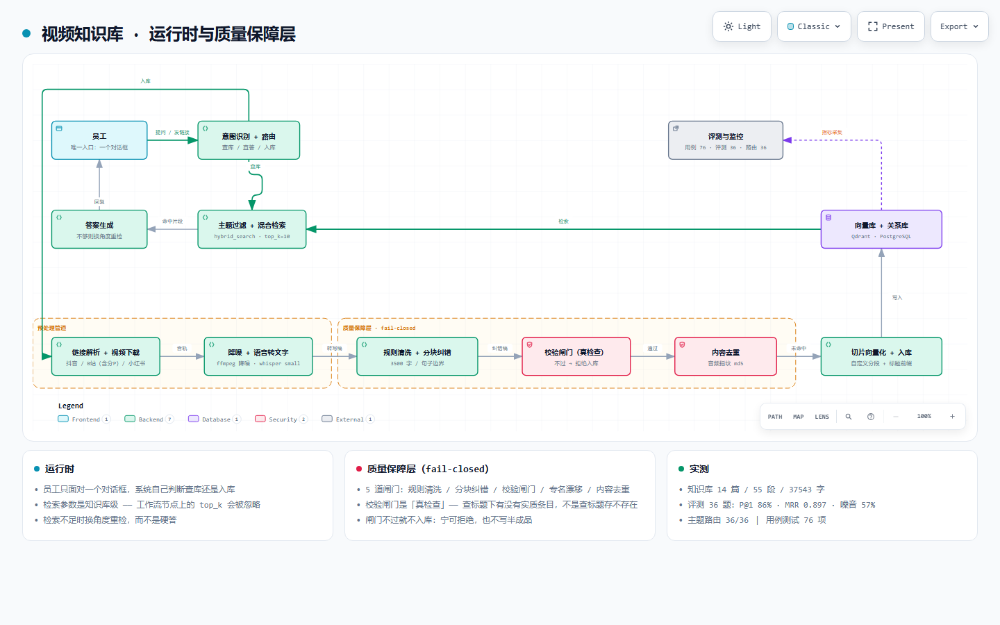

# video-to-knowledge-base

> 把视频链接变成可问答的 AI 知识库
> 抖音 / 小红书 / B站 → 自动转写 → LLM 纠错 → 向量入库 → 自然语言问答

**一条 11 分 37 秒的视频，从粘贴链接到可以提问，147 秒。全程零 API 成本。**

**⭐ 员工只面对一个对话框：发链接就入库，提问就查库 —— 系统自己判断该做哪件。**

---

## 目录

- [它解决什么问题](#它解决什么问题)
- [实测性能](#实测性能)
- [效果截图](#效果截图)
- [系统架构](#系统架构)
- [核心设计：对话式入库](#核心设计对话式入库)
- [合规设计](#合规设计)
- [快速开始](#快速开始)
- [导入工作流后必须手工做的事](#导入工作流后必须手工做的事)
- [项目结构](#项目结构)
- [技术亮点](#技术亮点)
- [踩过的坑](#踩过的坑)
- [已知局限](#已知局限诚实说明)
- [环境要求](#环境要求)
- [License](#license)

---

## 它解决什么问题

看技术视频时想回看某个点，**得拖进度条一段段找**。11 分钟的视频，想定位到「他讲显存那段」，基本靠运气。平台也没有「按语义搜视频内容」的功能。

这个工具把视频转成可检索、可问答的知识库：

| 传统做法 | 这个工具 |
|---|---|
| 想回看「他讲的那个参数是多少」→ 手动拖进度条 | 直接问，几秒给答案并标注来源 |
| 十几个视频散在收藏夹，没法跨视频检索 | 统一入库，跨视频提问 |
| 视频没有文字稿，不可搜索 | 自动转写 + 纠错 + 结构化 |
| 看完就忘，别人再问还得重看 | 一个对话框，全员可查 |

---

## 实测性能

全部为真实测量（多条真实视频，含一个 11.6 分钟的长视频）：

| 视频时长 | 抓取 | ASR 转写 | LLM 纠错 | **全链路** | 转写倍率 |
|---|---|---|---|---|---|
| 27 秒（抖音） | 1.0s | 4.0s | 2.1s | **15.1s** | 6.86x |
| 87 秒（B站） | 1.1s | 19.3s | 3.5s | **31.6s** | 4.58x |
| 145 秒（抖音） | 3.1s | 44.1s | 5.4s | **61.1s** | 3.34x |
| 174 秒（抖音） | — | — | — | **66.6s** | — |
| 234 秒（抖音） | — | — | — | **80.4s** | — |
| **697 秒（B站）** | 3.7s | 130.9s | 11.5s | **147.2s** | 5.58x |

**关键结论（实测修正了初版估算）：**
- 转写倍率**波动很大**（3.34x ~ 6.86x），不是平滑曲线
- 保守规划值：**1 小时音频 ≈ 15–18 分钟**（最初估 9 分钟，偏乐观）
- **全程零 API 成本**：ASR 本机跑，抓取工具自托管

**验收测试：**

| # | 测试 | 结果 |
|---|---|---|
| ① | 各问一个专属问题 | ✅ 全部正确，均标注来源 |
| ② | 跨视频区分 | ✅ 正确识别视频来源 |
| ③ | **防幻觉：问知识库里没有的内容** | ✅ **正确回答「没有」并引导入库** |
| ④ | 意图分流（该查库 / 该直答 / 该入库）| ✅ 8/8 正确 |
| ⑤ | 主题分库（按主题过滤检索）| ✅ 召回从 10 条（混在一起）降到 3-4 条（纯该主题）|
| ⑥ | 合规过滤（不含他人原文）| ✅ 含原文的段落数 **0** |
| ⑦ | 架构图渲染校验 | ✅ 9/9 检查、4 个分辨率无溢出 |
| ⑧ | 工作流发布 | ✅ 2/2 |

---

## 效果截图

**问答实测**（工作流 + 回答 + 来源标注同框）：


**知识库文档列表**（真入库，标签可见「混合检索」）：


**两个工作流**：

| ① 转写稿纠错与知识点提取 | ② 视频知识库问答 |
|---|---|
|  |  |

**系统架构图**（可交互版：[docs/架构图.html](docs/架构图.html)，含明暗主题 / 语义视图 / 导出）：



> 图中 `质量保障层 · fail-closed` 那一段是本项目与常见 RAG 项目的差别所在，详见 [`docs/质量保障层.md`](docs/质量保障层.md)。

---

## 系统架构

```
┌─────────────────────────────────────────────────────────┐
│  员工面对的唯一入口：一个对话框                            │
└─────────────────────────────────────────────────────────┘
                          │
        ┌─────────────────┴─────────────────┐
        │      意图判断（LLM 输出 1/2/3）      │
        └─────────────────┬─────────────────┘
                          │
     ┌────────────────────┼────────────────────┐
     │ 3=入库             │ 1=查库             │ 2=直答
     ▼                    ▼                    ▼
┌─────────────┐  ┌──────────────────┐  ┌─────────────┐
│ 提取链接     │  │ 改写为检索式      │  │ 直接回答     │
│ HTTP 提交    │  │ 主题判断          │  │ （闲聊）     │
│ 回执「已受理」│  │ 混合检索          │  └─────────────┘
└──────┬──────┘  │ 评估够不够        │
       │         │ ├─ 够 → 作答      │
       │         │ └─ 不够 → 换角度重检│
       │         └──────────────────┘
       │
       ▼
┌─────────────────────────────────────────────────────────┐
│  入库服务（独立进程，:8090，不随 Docker 启停）             │
│                                                         │
│  POST /ingest    收链接 → 立即返回 job_id（不等）         │
│  GET  /jobs/<id> 查进度                                 │
│  GET  /health    五项依赖健康检查                         │
│                                                         │
│  后台跑（含 5 道质量闸门）：                              │
│   ① 链接解析  ② 视频下载（支持 B站多分P）                 │
│   ③ 音频提取（含降噪）  ④ 音频指纹去重                     │
│   ⑤ 语音转文字  ⑥ 规则清洗（句首口头语）                   │
│   ⑦ 分块 map-reduce 纠错 + 校验闸门 + 专名漂移检查         │
│   ⑧ 合规过滤 + 事实摘录  ⑨ 切片向量化  ⑩ 元数据入库       │
└─────────────────────────────────────────────────────────┘
```

**⭐ 运行时之外还有一层「质量保障层」** —— 它不参与数据流，只回答一个问题：**怎么知道它坏了**。

| 5 道闸门 | 治什么 |
|---|---|
| 规则清洗 | ASR 稿的句首口头语噪音 |
| 分块 map-reduce 纠错 | LLM 输出被 `max_tokens` 截断 → 内容全丢 |
| **校验闸门（真检查）** | 「有标题但标题下没内容」的假通过 → **拒绝入库** |
| 专名漂移检查 | LLM「纠错」把正确的专名改错（`Act` → `Actor`）|
| 内容去重（音频指纹） | 同一节课的重复投稿按链接入库两次 |

**3 层测试**：76 项用例测试 + 36 题端到端评测（P@1 / MRR / 噪音）+ 36 题主题路由测试。
详见 [`docs/质量保障层.md`](docs/质量保障层.md)。

**⭐ 为什么入库要拆成独立服务，见下一节。**

---

## 核心设计：对话式入库

### 问题：入库慢，但对话不能干等

| 视频时长 | 入库耗时 |
|---|---|
| 27 秒 | 15.1 秒 |
| 87 秒 | 31.6 秒 |
| 145 秒 | 61.1 秒 |
| **11 分 37 秒** | **147.2 秒** |

**而 Dify 的工作流是同步的，默认超时 60 秒 —— 长视频直接失败。**

**更要命的是：「先回复『收到』，再后台慢慢跑」这件事，同步工作流做不到。**

### 解法：Dify 只做「受理」，重活交给外部服务

```
员工发链接
   │
   ├─ 意图判断 → 输出 3
   ├─ 提取链接（代码节点，正则抓 URL）
   ├─ HTTP 节点 → POST http://host.docker.internal:8090/ingest
   │                 ↓ 立即返回 202 + job_id（不等）
   └─ 组装话术 → 回复「收到，任务编号 xxx」
                          │
                          ↓
        ┌─────────────────────────────────────┐
        │  入库服务（独立进程，端口 8090）      │
        │  后台线程跑完整链路                   │
        └─────────────────────────────────────┘
```

### 这个判断为什么重要

**两条约束合起来，只剩「异步受理」这一条路：**

1. **员工不会用命令行** → 入库必须走对话
2. **入库慢到不能同步等** → 必须有异步

**⭐ 所以：Dify 负责「受理 + 回执」，真正的重活在外面跑。员工 1 秒内收到回复。**

### 入库服务的实现

**零依赖**，只用 Python 标准库 `http.server`：

| 端点 | 作用 | 返回 |
|---|---|---|
| `GET /health` | 健康检查 | 逐项检查 Ollama / Dify / ffmpeg / node / 抓取服务 |
| `POST /ingest` | 提交链接 | `202` + `{job_id, status:"queued"}`，**立即返回** |
| `GET /jobs/<id>` | 查单个任务 | `{status, stage, progress, title, doc_id, logs}` |
| `GET /jobs` | 最近 20 个任务 | `{jobs: [...]}` |

**任务状态机：**
```
queued(排队中) → running(下载中 5% → 转写中 25% → 纠错中 60% → 入库中 80%)
                                              → done(100%) / failed
```

**⭐ 为什么不用 FastAPI**：机器上没装，而服务只有 4 个端点。
**为了 4 个端点去装一个框架、还会污染 Python 环境，不划算。**

**⭐ 任务落盘**（`_ingest-jobs.json`），服务重启后历史还在。

---

## 合规设计

**⚠️ 这一节很重要。抓取他人视频、转成文字、存进公司知识库，法律上属于「复制表达」。**

### 思想 / 表达二分法

著作权法有个基本原则：

| | 受保护 | 例子 |
|---|---|---|
| **思想** | ❌ **不受保护** | 「先讲痛点再给方案」的结构；「三线性差值省显存」这个知识点 |
| **表达** | ✅ 受保护 | 他具体说的那段话、那个文案、那个画面 |

**⭐ 就算是「只给一家公司内部用」也不构成豁免** ——
使用主体是商业实体、目的是经营活动、用了他人的作品，三个条件都满足就属于商业使用。

### 所以入库内容改成三段式

纠错工作流输出三节，**默认只保留后两节 + 一个限量摘录**：

| 分节 | 存不存 | 原因 |
|---|---|---|
| `## 校对稿` | ❌ **不入库** | 他人完整原文 = 受保护的「表达」|
| `## 知识点` | ✅ 入库 | 提炼产物，属于「思想」|
| `## 问答对` | ✅ 入库 | 同上，且问答形式对检索更友好 |
| `## 关键参数（原文摘录）` | ✅ 入库 | **数值、参数名是事实，不受保护**；且是检索最有用的信息 |

### 「关键参数」为什么可以留

**数值、型号、参数名是事实，不受保护。而它们恰恰是检索最有用的信息**
（用户常问「显存多少」「几步」「哪个版本」）。

**三条限制防变相保留全文：**
1. 只摘含数值或已知参数名的句子，纯观点句不摘
2. 总长封顶 **700 字**
3. 明确标注「原文摘录」，不冒充自己的话

### 控制开关

```bash
# 默认（合规）：只留 知识点 + 问答对 + 事实摘录
# 不设这个变量即可

# 回退（三节全存，仅本地测试用）
export KEEP_SECTIONS="校对稿,知识点,问答对"
```

### 改造效果

| | 改造前 | 改造后 |
|---|---|---|
| 知识库总字数 | 9087 字 | **6133 字** |
| 含他人原文的段 | 每个文档 2–3 段 | **0** |
| 口语特征词（原文痕迹）| 多处 | **1** |
| 检索通过率 | 5/6 | **7/8** |

**⭐ 意外收获：去掉原文后检索反而更准了** ——
问答对的命中得分（0.489）比原文（0.455）还高，因为「问题→答案」形式跟用户提问天然匹配。

---

## 快速开始

### 方式 A：只想看代码和设计（推荐）

不需要跑起来。看这些：

| 文件 | 内容 |
|---|---|
| [`docs/技术文档.md`](docs/技术文档.md) | **最有价值**：26 个真实踩坑记录，含源码行号 |
| [`scripts/one-click-pipeline.py`](scripts/one-click-pipeline.py) | 主脚本（含大量注释说明「为什么这样做」）|
| [`scripts/ingest-service.py`](scripts/ingest-service.py) | 入库服务（零依赖）|
| [`workflows/`](workflows/) | 两个 Dify 工作流 DSL（可导入）|
| [`docs/架构图.html`](docs/架构图.html) | 可交互架构图（切主题/缩放/导出）|
| [`samples/输出格式示例.md`](samples/输出格式示例.md) | 处理后的输出长什么样（虚构示例）|

### 方式 B：跑通 ASR 部分

只需要 Python + ffmpeg，不需要 Dify：

```bash
# 1. 装依赖
pip install faster-whisper opencc numpy requests

# 2. 准备一个视频/音频文件

# 3. 转写（绕过 faster-whisper 的 PyAV bug，见下方说明）
python scripts/test-asr2.py your-video.mp4 small
```

`test-asr2.py` 会打印：音频时长、转写耗时、**实时倍率**、带时间戳的转写结果。

> ⚠️ **为什么要单独写这个脚本**：faster-whisper 1.1.0 / 1.2.1 都有个 PyAV 兼容 bug（`av.open(..., metadata_errors=...)` 参数在某些 PyAV 版本上不存在）。这个脚本用 ffmpeg 自己抽音频、转成 numpy 数组直接喂模型，**绕过了 `decode_audio`**。详见技术文档「坑 5」。

### 方式 C：跑通全链路

需要 Docker + Dify + Ollama，步骤：

```bash
# 1. 部署 Dify（官方 docker compose）
#    https://docs.dify.ai/getting-started/install-self-hosted

# 2. 部署抓取服务
docker run -d --name dtk-v4 -p 8080:80 --restart unless-stopped \
  evil0ctal/douyin_tiktok_download_api:V4.1.2

# 3. 部署小红书抓取（可选）
#    https://github.com/JoeanAmier/XHS-Downloader
#    python main.py API      # 监听 :5556

# 4. 导入两个工作流
#    Dify 工作室 → 创建 → 导入 DSL 文件 → 选 workflows/*.yml
#    ⚠️ 导入后必须手工重选知识库（见下方「导入注意事项」）

# 5. 建知识库 + 配混合检索
#    知识库设置里把检索方式改成 hybrid_search（见技术文档「坑 4」）

# 6. 配模型
#    Embedding 用 Ollama + nomic-embed-text
#    LLM 用 DeepSeek（或改选你有的）

# 7. 配置
cp scripts/config.example.py scripts/config.py
# 编辑 config.py 填入：Dify 地址、知识库 ID、工作流 app ID、ffmpeg 路径

# 8. 跑命令行入库
python scripts/one-click-pipeline.py "https://v.douyin.com/xxxxx/"

# 或起入库服务（对话式入库用）
cd scripts && ./入库服务.ps1        # Windows
python ingest-service.py           # Linux / macOS
```

---

## ⚠️ 导入工作流后必须手工做的事

**1. 重新选知识库**

DSL 里的 `dataset_ids` 被 Dify 导出时剥离了。需要在「知识检索」节点里重新选你自己的知识库。

**2. 重新选模型**

DSL 里写的是 `langgenius/deepseek/deepseek` / `deepseek-flash`。如果你的 Dify 没配 DeepSeek，节点会显示「不兼容」，需要改选你有的模型。

**3. 重建「主题判断」提示词**（问答工作流）

DSL 里的主题判断提示词是**模板占位符**（`【类别A】《视频标题 1》`），
需要换成你知识库的真实内容。**仓库里带了一个脚本自动做这件事：**

```bash
cd scripts
node sync-topic-prompt.mjs --dry-run    # 先看会生成什么
node sync-topic-prompt.mjs --publish    # 生成 + 写入 + 发布
```

它会读出知识库里每个文档的标题和知识点，按主题分组，生成分类描述写进 `llm_topic` 节点。

> ⭐ **为什么必须做这一步**：主题判断靠提示词里的分类描述来判。描述跟实际内容对不上就会判错。
> 实测教训：手写的泛泛分类 4 题全错；改成从知识库自动生成后 0/4 → 4/4。
> **每次加新视频后都要重跑这个脚本**，否则新视频判不出主题。

**4. 改元数据字段 ID**（问答工作流）

DSL 里有两处 `REPLACE_WITH_YOUR_TOPIC_METADATA_ID`。这是「主题过滤」用的元数据字段 id，
**你在自己 Dify 里建的字段 id 会不同**，要替换掉。

```bash
# 拿字段 id
curl -X GET "http://localhost/console/api/datasets/<知识库ID>/metadata" \
  -H "Cookie: <你的 console cookie>"
```

**5. 建「主题」元数据字段 + 给文档打标签**

不加这一步，检索会按主题过滤，新文档会被过滤掉。

```bash
# 建字段
curl -X POST "http://localhost/console/api/datasets/<知识库ID>/metadata" \
  -H "Content-Type: application/json" \
  -d '{"type":"string","name":"主题"}'

# 打标签
curl -X POST "http://localhost/console/api/datasets/<知识库ID>/documents/metadata" \
  -H "Content-Type: application/json" \
  -d '{"operation_data":[{"document_id":"<文档ID>",
       "metadata_list":[{"id":"<字段ID>","name":"主题","value":"AI工具"}]}]}'
```

**6. 知识库要开混合检索**（否则检索质量差很多）

```json
{
  "search_method": "hybrid_search",
  "reranking_mode": "weighted_score",
  "reranking_enable": true,
  "weights": { "vector_weight": 0.5, "keyword_weight": 0.5 },
  "top_k": 10
}
```

> ⚠️ **注意**：这个配置要改**知识库级**的 `retrieval_model`，改工作流节点的没用 —— 因为 Dify 的检索参数读的是知识库配置。详见技术文档「坑 4」。

**7. 允许 Dify 访问本机**（对话式入库需要）

Dify 有个 Squid 代理拦截出站请求，默认不允许访问内网。要在 `.env` 里把你的宿主机 IP 加白名单：

```ini
SSRF_PROXY_ALLOW_PRIVATE_IPS=172.19.0.250/32,192.168.65.254/32
```

**⭐ 拿 IP 的方法**（会同时返回 IPv6 和 IPv4，**要用 IPv4**）：
```bash
docker exec docker-api-1 getent ahosts host.docker.internal
```

详见技术文档「坑 22」。

---

## 项目结构

```
video-to-knowledge-base/
├── README.md                          本文件
├── LICENSE                            MIT
├── .gitignore
├── .gitattributes                     换行符 + .ps1 BOM 保护
├── docs/
│   ├── 技术文档.md                     ⭐ 最有价值：30+ 个坑的完整排查记录
│   ├── 质量保障层.md                    ⭐ 闸门 / 专名漂移 / 内容去重 / 评测体系
│   ├── 架构图.html                     可交互架构图（含质量保障层）
│   └── images/                         5 张截图
├── workflows/
│   ├── 01-transcript-correction.yml     Dify 工作流①（纠错 + 知识点提取）
│   └── 02-video-kb-qa.yml               Dify chatflow②（20 节点 / 19 连线）
├── scripts/
│   ├── one-click-pipeline.py           主脚本（下载→降噪→转写→分块纠错→闸门→入库）
│   ├── ingest-service.py               入库服务（零依赖 HTTP 服务）
│   ├── reingest-compliance.py          合规重入库（用本地视频重跑）
│   ├── 入库服务.ps1                     入库服务的启动脚本（Windows）
│   ├── 启动全部服务.ps1                  一键起全部依赖 + 开机自启
│   ├── sync-topic-prompt.mjs           从知识库重建主题判断提示词 ⭐
│   ├── test-asr2.py                    独立 ASR 脚本（方式 B 用）
│   ├── config.example.py               配置模板
│   └── dify-bridges/                   Dify 桥接脚本（放进 dify-mcp 目录用，见其中 README）
│       ├── _run-correction.mjs         调纠错工作流
│       ├── _add-document.mjs           建知识库文档
│       ├── _upload-file.mjs            文件上传（绕开 Windows 命令行长度上限）
│       ├── _bind-topics.mjs            给文档绑「主题」元数据
│       ├── _fix-topic-prompt.mjs       按知识库实际内容重建主题判断提示词
│       ├── _probe-hit.mjs              检索探针（看实际命中与排名）
│       └── _export-docs.mjs            知识库导出（兼备份）
├── tests/                              ⭐ 76 项用例测试（切块 / 去重 / 闸门 / 专名 / 评测器）
├── evaluation/                         ⭐ 评测体系（端到端 36 题 + 路由 36 题 + 基线）
│   ├── 评测集.json                      端到端评测集（要点 + 期望视频）
│   ├── eval.py                        端到端评测（P@1 / MRR / 噪音占比）
│   ├── 路由测试集.json                  主题路由测试集
│   ├── route_test.py                  主题路由测试
│   └── 基线.json                       当前基线
├── skill/                             配套 Agent 技能（示例：怎么给项目写 skill）
│   ├── SKILL.md
│   ├── references/
│   │   ├── 01-排障手册.md               12 个常见故障
│   │   └── 02-接口说明.md               接口 / 资产 ID / 配置
│   └── scripts/
│       ├── ingest.mjs                  入库 CLI（查健康→提交→轮询）
│       └── ask.mjs                     问答 CLI
└── samples/
    └── 输出格式示例.md                  处理后的输出长什么样（虚构示例）
```

---

## 技术亮点

### 1. 用 LLM 纠错代替换大模型

实测 `whisper-small` 与 `whisper-medium` **各有对错**（`medium` 把「详情页」听成「详情业」）。与其花 2.5 倍时间换 `medium`，不如 `small` + LLM 纠错 —— **LLM 能靠上下文改对 ASR 根本改不对的词**：

| ASR 原始输出 | LLM 纠错后 |
|---|---|
| Coffee UI / Coffee MCP | **ComfyUI / Comfy MCP** |
| 它把 Cloud、Codex 连上 | 它把 **Claude**、Codex 连上 |
| 号称 AI 时代的**合法强节** | 号称 AI 时代的**合法外挂** |
| 增强**晚膳** / 重新**减**回 | 增强**完善** / 重新**捡**回 |

### 2. 三重防御压掉推理模型的「思考过程污染」

`deepseek-flash` 是推理模型，输出会带 `<think>` 块，在 Dify 工作流里会被当成正文。三重防御：

| 层 | 做法 |
|---|---|
| ① 源头 | LLM 节点 `completion_params` 加 **`thinking: false`** |
| ② 引导 | 提示词写「输出纪律」段：禁止输出思考过程 |
| ③ 兜底 | 代码节点正则剥离（`<think>` + HTML 注释 + 代码围栏）|

### 3. 自定义分段 + 标题前缀，解决跨视频串台

Dify 自动分段把 12 分钟视频切成 18 段、不带来源标识 → **多个视频的片段互相串台**（实测某个查询命中了另一视频讲「调色台」的片段 0.786）。

改成每块以 `【视频标题】` 开头后：

| 方案 | 第 1 名 | 第 2 名 |
|---|---|---|
| 自动分段 | 0.786 **错误视频** ❌ | 0.760 正确 |
| **自定义 + 标题前缀** | **0.803 正确** ✅ | **0.787 正确** ✅ |

### 4. 混合检索（关键词 + 向量加权）

**排查了三层才找到真凶** —— 检索参数读的是**知识库级**配置，工作流节点上的 `top_k` / `weights` **全部被忽略**：

```python
# Dify 源码 api/core/rag/retrieval/dataset_retrieval.py 行 738
retrieval_model_config = selected_dataset.retrieval_model   # ← 知识库级，不是节点级
top_k = retrieval_model_config["top_k"]                     # ← 节点 top_k 被忽略
retrieval_method = retrieval_model_config["search_method"]   # ← 节点配置不参与
```

而且只有 `hybrid_search` 才走「weights 加权融合」分支。改成知识库级配置后，检索条数 4 → 7-10，「错误视频排第一」变成「正确视频排第一」。

### 5. 主题分库：用元数据过滤缩小检索范围

**⭐ 一个反直觉的发现：Dify 的元数据 API 标注了 `@enterprise_license_required`，但社区版实测可用。**

做法：
1. 建一个 `主题` 元数据字段（string 类型）
2. 给每个文档打标签（AI工具 / AI视频 / 电商运营 / AI应用）
3. 检索前加一个「主题判断」节点（LLM 输出类别名）
4. 检索节点的 `metadata_filtering_conditions` 的 **value 引用该节点的输出**（`{{#llm_topic.text#}}`）

**效果：**

| | 不过滤 | 按主题过滤 |
|---|---|---|
| 每题召回条数 | 10 条（几个主题混在一起）| **3–4 条（只含该主题）** |
| 头条是否命中正确视频 | 不稳定 | **稳定命中** |

**⭐ 关键点 1：过滤条件的 value 支持变量引用** ——
所以不用建 5 个分支，一个检索节点就能按主题动态筛选。

**⭐ 关键点 2：`metadata_filtering_mode: "automatic"` 不能用** ——
让 Dify 自动推断过滤条件，实测全返回 0 条。**必须用 `manual` + 明确条件。**

### 6. 意图三分支：一个对话框干三件事

```
意图判断（LLM 输出 1/2/3）
  ├─ 3 = 链接入库
  ├─ 1 = 查知识库
  └─ 2 = 直接回答
```

**⭐ Dify 的 if-else 支持多 case**（`_targetBranches` + `cases`），一个节点就能做三分支。

**⭐ 顺序很重要：先判「入库」（更具体），再判「查库」。**

**⭐ 踩过的坑：`question-classifier` 节点不好用** ——
它内置的是英文客服反馈的少样本示例，跟中文技术问答场景不匹配，
同一个问题反复判错。换成普通 LLM 节点输出 1/2/3 + if-else，5 题全对。
**内置专用节点不一定比通用节点好。**

### 7. 会话记忆：`memory` 不是 `context`

**⭐ 这两个是不同字段，配错了完全没效果：**

| 字段 | 作用 |
|---|---|
| `context` | 注入**检索结果** |
| `memory` | 管**历史对话** |

配在 `context` 上，多轮对话里「它」「这个参数」这类指代词消解不了。

### 8. 合规：只存「思想」，从原文里只摘「事实」

见上面[合规设计](#合规设计)一节。核心是**思想 / 表达二分法**：

- 知识点、问答对 = **思想** → 保留
- 校对稿（完整原文）= **表达** → 丢弃
- 含数值/参数的句子 = **事实** → 限量摘回（封顶 700 字）

**⭐ 意外收获**：问答对的命中得分比原文还高（0.489 vs 0.455）。

### 9. 分块 map-reduce 纠错 + 「真检查」闸门（治静默丢数据）

**事故**：一个 64 分钟视频入库后**只剩 105 个字**，而流程打印的是「✅ 完成」。
真因是纠错 LLM 输出 `finish_reason = "length"` 被截断，截断位置恰好让两节没生成，
合规策略又正确地丢掉了剩下的那节 → **主体全丢，且无一处报错**。

**修法**：

| 措施 | 做法 |
|---|---|
| 分块 | 按 **3500 字 / 句子边界**切成多块，逐块纠错再合并去重（`''.join(分块) == 原文` 校验不丢字）|
| 显式上限 | 纠错节点 `max_tokens = 8000` + `thinking = false` |
| **闸门** | 每块必须**有实际条目**的 `## 知识点` 和 `## 问答对`，否则**拒绝入库** |

**⭐ 「真检查」与「存在性检查」的差别是核心**：

| | 存在性检查（错） | 真检查（对） |
|---|---|---|
| 判据 | 文本里有 `## 知识点` 这几个字 | 该标题下**至少有 N 条实质条目** |
| 截断的输出 | ✅ 误判通过 | ❌ 正确拦下 |

**效果**：同一个 64 分钟视频 —— **105 字 → 9178 字 / 12 段**。

### 10. 专名漂移检查：专名不信任 LLM 纠错

**真实事故**：转写稿里正确的 `Reason加Act`，被 LLM「纠错」改成 `Reason加Actor`，然后写进了库。

**做法**：从**原始转写稿**抽候选专名 → 纠错后按**词边界**逐个核对还在不在 →
不在就用相似度猜「被改成了什么」并告警。

```
专名漂移告警（原稿有、纠错稿里没了）：
  · Act → 疑似被改成 Actor（相似度 0.75）
```

**实现踩的两个坑**（都已修）：
- **子串匹配太松**：`Act` 是 `Actor` 的子串 → 事故**漏报**。必须加字母/数字词边界
- **猜测误报**：`ReAct` 与 `Actor` 对 `Act` 的相似度都是 0.75 → 不筛「原稿里没有的新词」就会误报

**⚠️ 诚实说明**：这是**降级方案**。理想解是「**专名以画面 OCR 为准**」（声学模型解决不了同音词，
如「短距」/「短剧」），本机未接 OCR，所以做的是把**静默改写变成可见告警**。

### 11. 内容去重：按内容分，不按链接分

一个 19 分P 的课程里，**P2 和 P3 是同一节课的重复投稿**（标题一样、时长一样）。

**怎么确认的**（不是靠标题猜）：

| 对比项 | P2 | P3 |
|---|---|---|
| **全量音频 MD5** | `D6CB799B29CE…` | **完全相同** |
| 精确时长 | 362.927891 秒 | 362.927891 秒 |
| 视频文件 | 8.9 MB | 9.2 MB（**重编码过，所以不同**）|

→ 音频逐字节相同 = 同一份录音；视频不同只因重新编码。

**做法**：下载后先算**音频前 120 秒的 md5**，命中台账就跳过（连转写都不做）。

**为什么用音频指纹**：标题可能被改、可能被截断、也可能重名却内容不同 —— **内容指纹不会骗人**。

**分辨力验证**（防「把不同课当重复丢掉」）：同一文件两次指纹必须相同，
且**不同音频必须算出不同指纹**（这条比上一条更重要）。

### 12. 评测体系：打分器自己也要有「分辨力」

**为什么**：如果评测**全过**，它证明不了自己能发现问题 —— 打分器写松了，将来真出回归也会报「通过」。

所以我们写了两套东西：

| 层 | 规模 | 测什么 |
|---|---|---|
| 用例测试 | **76 项** | 代码逻辑（切块/去重/闸门/专名/评测器本身）|
| 端到端评测 | **36 题**（29 题带期望视频）| 答案对不对 **+ 检索对不对**（P@1 / MRR / 噪音）|
| 主题路由测试 | **36 题** | 只测「该判到哪个主题」|

**打分器自检 18 项**（两头都测）：**8 个坏产出必须被判不过**（缺要点/半命中/含禁用词/含错误专名/
该拒答却答/该直答却拒/越界没声明/意图不符）+ **6 个好产出必须判通过**。

**⭐ 补题的代价与价值**：题库从 22 题补到 36 题（覆盖全部文档）后，指标**大幅下降**：

| 指标 | 22 题时 | 36 题时 |
|---|---|---|
| 计分题通过 | 20/20 (100%) | **29/34 (85.3%)** |
| P@1 | 15/15 (100%) | **25/29 (86%)** |
| MRR | 1.000 | **0.897** |
| 噪音占比 | 41% | **57%** |

**这不是系统变差了，是终于测出来了。** 补题立刻暴露三类真问题：主题误判（3 例）、检索召回（1 例）、答案不完整（1 例）。
**不做这些题，就永远不知道改动有没有把检索搞坏。**

### 13. 提示词膨胀 → 分类退化（库变大后才显形的问题）

**因果链（有对照实验）**：

| | 库 8 篇 | 库 26 篇 |
|---|---|---|
| 主题判断提示词 | 2079 字（塞了**全库**标题+知识点）| **6335 字** |
| 「调色台的操作流程」判到 | `AI视频` ✅ | **`AI工具`** ❌ |
| 结果 | 正常回答 | 主题过滤挡掉正确文档 → **拒答** |

**修法**：提示词改成**紧凑版** —— 每类只留有限个高辨识度关键词（**大小与库规模脱钩**）+ 显式消歧规则。
**6335 字 → 744 字（−88%，每问省约 2800 token）**，主题判断恢复正确。

> **教训**：把一个**会随数据规模增长**的东西（全库内容）塞进提示词，短期能跑、**长期必坏**。
> 提示词的复杂度应该与**业务复杂度**挂钩，不该与**数据量**挂钩。

---

## 踩过的坑

**完整 30+ 个坑见 [`docs/技术文档.md`](docs/技术文档.md)**，每条都写清「现象 → 排查 → 真因 → 教训」。这里列几个最有代表性的：

| # | 坑 | 一句话 |
|---|---|---|
| 1 | 转写不准，换更大的模型没用 | small 和 medium 各有各的错，加 LLM 纠错更有效 |
| 2 | 片尾客套话把检索带偏 | 「记得点赞关注」短且全是高频词，跟任何问题都像 |
| 3 | **测试全绿，但覆盖的场景太窄** | 最初问的问题「总结片段」恰好就是正确答案，掩盖了提示词漏变量的缺陷 |
| 4 | 改检索参数完全没反应 | 读源码发现节点级配置无效，读的是知识库级 |
| 5 | **检索返回 0 条，根因不在提示词层** | 其实是 Ollama 没跑。排查顺序应该是「服务层 → 数据层 → 提示词层」|
| 6 | 多轮对话「它」指代不了 | `memory` 不是 `context` |
| 7 | 意图分类不稳定 | `question-classifier` 的示例场景不匹配，换普通 LLM 节点 |
| 8 | 员工不会用命令行 → 这个需求决定了整个架构 | 加上「入库慢不能同步等」，只剩「异步受理」一条路 |
| 9 | **主题判断全错，因为依据跟实际数据对不上** | 分类描述按经验写的；改成从知识库读真实内容自动生成，0/4 → 4/4 |
| 10 | 合规：入库内容不能是他人原文 | 按「思想/表达二分法」重新设计入库内容 |
| 22 | Dify 的 SSRF 保护挡住内网调用 | 要把 `host.docker.internal` 的 **IPv4**（不是网段网关）加白名单 |
| 25 | **先分清是「素材问题」还是「模型问题」** | 有一题一直拒答，我以为是模型幻觉；核对原始转写稿后发现是**视频作者自己说错了** |
| 26 | **长视频静默丢数据** | 64 分钟视频入库只剩 105 字，流程却报「✅ 完成」—— 真因是 LLM 输出被 `max_tokens` 截断 |
| 27 | **内容超 8000 字就入不了库** | 上传 payload 走命令行，base64 爆 Windows 32767 字符上限（`WinError 206`）；CLI 又不支持 `@file`/stdin → 改用桥接脚本直调 API |
| 28 | **模块在一个进程里只能 import 一次** | 无条件包 `sys.stdout`，第二次 import 时底层 buffer 已关闭 → `ValueError: I/O operation on closed file` |
| 29 | **专名检查漏报** | 用子串判断「专名还在不在」→ `Act` 是 `Actor` 的子串，于是最该抓的改写被漏掉；必须按词边界匹配 |
| 30 | **库变大 → 主题提示词膨胀 → 分类退化** | 提示词从 2079 字涨到 6335 字后，「调色台」从 `AI视频` 误判成 `AI工具` → 正确文档被过滤 → 拒答 |
| 31 | **B站多分P 只入库了 P1** | 取的是 `fetch_one_video` 的**顶层 cid（= P1）**；分P 信息在 `pages[]` 里，不读就会静默丢 113 分钟 |
| 32 | **文档名不参与检索** | 查 Dify 源码 + 向量库 payload 确认：embedding 只吃 `page_content`；真正的「名字」是分段正文里的 `【标题】` 前缀 |
| 33 | **我自己的静默失败**：启动脚本用旧配置还报成功 | 订阅拉取超时 → 配置没生成，但目录里留着**上次的**配置 → 服务照常起来、检查也通过。修法：检查退出码 + 要求配置**本轮**更新过 |

**⭐ 坑 25 的教训最通用**：遇到「模型答错了」，先分清三种情况 ——
① 输入素材本身有问题（拒答是对的，不用改）② 模型提取失真（改提示词）③ 检索/路由错（改检索）。
**不做这一步核对，很容易去改一个本来没错的地方。**

---

## 已知局限（诚实说明）

| # | 局限 | 原因 | 可能的解法 |
|---|---|---|---|
| 1 | **RAG 做不了全库聚合统计** | 问「知识库里有几个视频」会答不准 —— RAG 只能检索 top_k 片段 | 用文档列表 API 单独做统计节点 |
| 2 | **跨主题问题会漏** | 主题判断只能选一个；如果一个问题同时沾两类，另一半会被过滤掉 | 评估不充分时第二次检索去掉主题过滤 |
| 3 | **向量检索偏好问句型内容** | 提问句式与片段里的设问句向量天然接近，会形成「高分磁铁」| 配 rerank 模型（本项目未做，因为 Ollama 不支持 `/api/rerank`）|
| 4 | **无语音的视频会退化为「只用标题+描述」** | 纯音乐/环境音的视频转写为空 | 已加检测与告警 |
| 5 | **B站 1080P 需要登录态** | 未登录只能拿 480P | 提供 Cookie |
| 6 | **新增视频要手动做两件事** | 打主题标签 + 更新主题判断提示词；漏了任一步新视频就查不到 | 做成入库后自动触发 |
| 7 | **没有账号体系** | 谁打开链接都能用 | 前面加一层登录 |
| 8 | **没有告警** | 已有监控层（每小时采集、看板、意图分布、检索指标）与评测体系，但**失败只能靠人看日志** | 接入告警（飞书 Webhook / Alertmanager）|
| 9 | **主题消歧规则是手写的** | 提示词里「哪些词归哪类」靠人工枚举，有**过度拟合**风险 | 已用 36 题路由测试集约束；长期应由数据自动生成 |
| 10 | **专名检查没有 OCR** | 声学模型解决不了同音词（「短距」/「短剧」），理想解是拿画面文字做锚 | 接入 OCR（本机未做）|
| 11 | **没有账号体系 / 限流** | 入库服务 `:8090` 无鉴权（靠只监听 `127.0.0.1` 缓解）| 前面加一层网关 |

---

## 环境要求

| 组件 | 用途 | 必需？ |
|---|---|---|
| Python 3.10+ | 跑脚本 | ✅ |
| ffmpeg | 抽音频、合并 B站 dash 流 | ✅ |
| Node.js 18+ | 调 dify-mcp CLI（操作 Dify）| 方式 C 需要 |
| Dify 1.17+（自托管）| 工作流 + 知识库 + RAG | 方式 C 需要 |
| Docker | 跑抓取服务 | 方式 C 需要 |
| Ollama + embedding 模型 | 向量化（本项目用 `nomic-embed-text`）| 方式 C 需要 |

**实测硬件基线：**
- CPU：6 核 12 线程（AMD Ryzen 5 8400F）
- 内存：**32 GB**（Dify 全套容器约吃 6–8 GB，转写时再吃 2–4 GB；**16 GB 是能跑的下限**）
- 硬盘：**60 GB 空闲**（Docker 镜像 12.5 GB + 模型 2.2 GB + 数据）
- 显卡：**不需要**（全程 CPU。显卡只在你想跑本地出图时才需要）

---

## License

MIT —— 见 [LICENSE](LICENSE)

**⚠️ 免责声明**：本项目的抓取模块仅用于**个人学习与研究**。
使用时请遵守各平台的服务条款与著作权规定，不要用于批量爬取或商业分发。

**⭐ 如果用于企业场景，建议把输入源从「抓公开视频」改成「上传公司自有视频」**
（培训录像、内部会议、自拍素材）—— 这样既无版权风险，内容质量也更高。

**⭐ 项目本身已做合规防护**：知识库只存「知识点 + 问答对 + 事实摘录」，
不含他人原文。详见[合规设计](#合规设计)。
